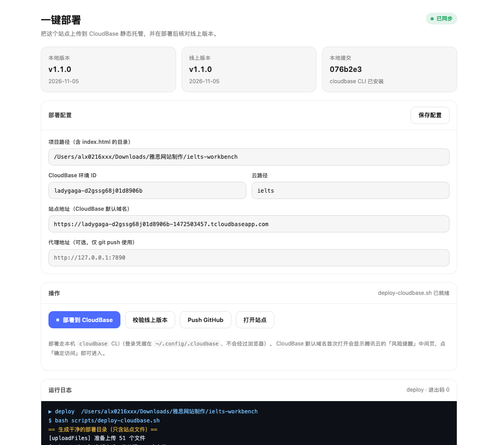

# dsh-deploy



DeepSeek Harness 侧栏「部署」面板：一键把当前静态站点上传到 CloudBase 静态托管，实时显示日志，并在部署后自动核对线上版本。

## 功能

- 左侧栏「部署」入口 + 一整页面板
- 配置：项目路径、CloudBase 环境 ID、云路径、站点地址、可选代理（仅 git push 用）
- 一键「部署到 CloudBase」：调用项目里的 `scripts/deploy-cloudbase.sh`
- 「校验线上版本」：调用 `scripts/check-deploy.mjs`
- 「Push GitHub」：`git push origin main`（走可选代理）
- 实时日志（轮询宿主 `/api/dsh-deploy/state`）、退出码、最近一次结果
- 本地 / 线上 `version.json` 对比与「已同步 / 线上不是最新」徽章
- 打开站点链接

## 安全

- 浏览器不接触任何密钥：CloudBase CLI 的登录凭据在 `~/.config/.cloudbase/auth.json`
- 配置存 `$DSH_HOME/dsh-deploy/config.json`（0600）
- 路由与官方 `/api` 同一条 Host/Origin + 会话 cookie 校验
- 只允许 `deploy | check | push` 三个白名单动作；项目路径必须是绝对路径且含 `index.html`；云路径禁止 `..`

## 安装 / 加载

```sh
cd ~/.dsh/profiles/<profile>
npm install --save "dsh-deploy@link:/absolute/path/to/packages/dsh-deploy"
```

```yaml
# cordis.patch.yml
- insert:
    - id: dsh-deploy
      name: 'dsh-deploy'
```

**desktop profile 是启动时加载：需要退出并重新打开 DeepSeek Harness。**
加载成功后会出现 `$DSH_HOME/dsh-deploy.boot.json`，左侧栏出现「部署」。

### 首次使用需要先填配置

仓库里的默认配置**全部留空**（不包含任何真实项目路径或云环境 ID），装上后请先在面板里填写：

| 配置项 | 说明 |
| --- | --- |
| 项目路径 | 你本地静态站点的绝对路径，必须含 `index.html` |
| CloudBase 环境 ID | 形如 `xxx-1234567890` |
| 云路径 | 部署到托管的子路径，可留空表示根目录 |
| 站点地址 | 部署后可访问的 URL，用于线上版本比对 |

面板上的「部署 / 校验线上版本 / Push GitHub」依赖项目里存在 `scripts/deploy-cloudbase.sh` 与 `scripts/check-deploy.mjs`；这两个脚本属于你的站点项目，本仓库不提供。

## 开发

```sh
npm i -D esbuild
npm run build      # src/ → lib/client.js（__ModuleLoader__ 契约）
node scripts/test-host.mjs    # 宿主半：4 条路由 + check 动作 + 校验
node scripts/test-client.mjs  # 客户端 bundle：导出与两个插槽注册
```

改完 `src/` 后 `npm run build`，再重启 DSH。

## 文件

```
index.js             宿主半：配置、spawn、日志、/api/dsh-deploy/*
src/client.js        侧栏图标 + 部署面板
src/bundle-entry.js  打包入口
lib/client.js        构建产物
scripts/build.mjs    esbuild 打包
scripts/test-*.mjs   两半的自测
cordis.patch.yml     插件 bundle 层
```

## 卸载

```bash
# 1) 从两个 profile 的 cordis.patch.yml 删掉 dsh-deploy 的 insert 行
# 2) 从两个 profile 的 package.json dependencies 删掉 dsh-deploy
# 3) 删除符号链接
rm ~/.dsh/profiles/{desktop,web}/node_modules/dsh-deploy
# 4) 重启 DeepSeek Harness
```

配置与日志保留在 `$DSH_HOME/dsh-deploy/`，如需彻底清理可删除该目录。
