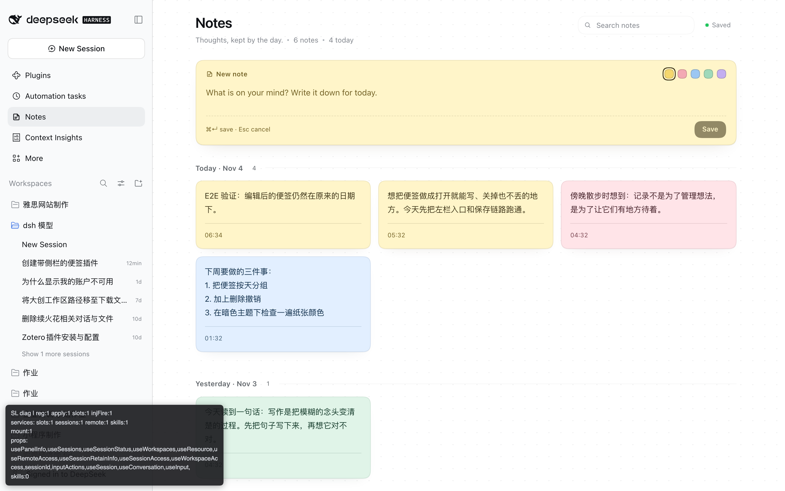
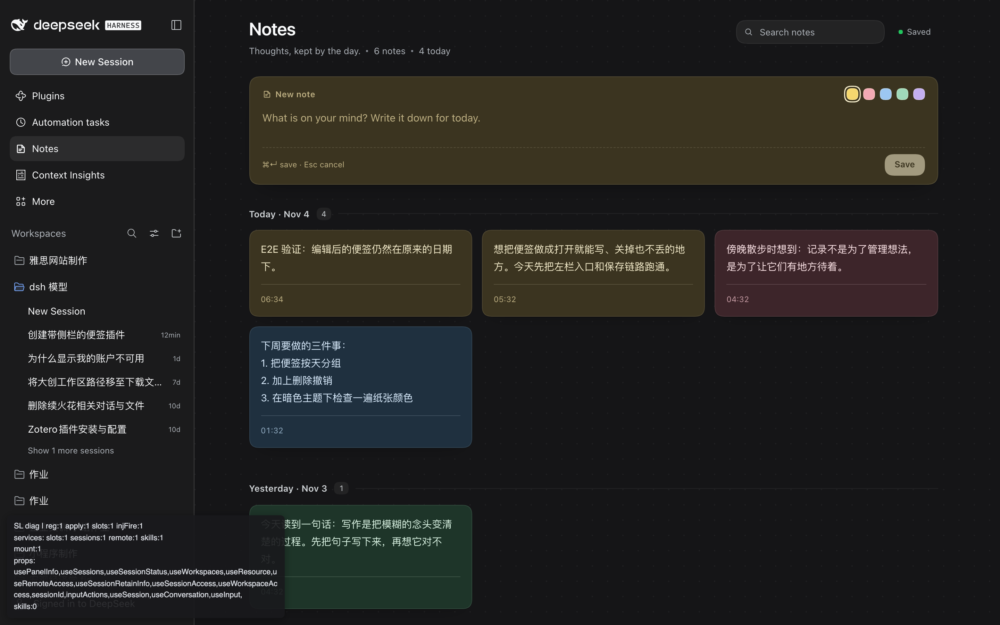

# dsh-notes

一个带左侧栏入口的 DSH 便签插件：把每天的想法写在彩色便签上，按日期自动归档，关掉再打开还在。



<details>
<summary>暗色主题</summary>



</details>

## 功能

- **左侧栏入口**：导航里的 `Notes / 便签` 一行，图标是一张折角便签；面板占据主区域，和「Plugins」「Automation tasks」同级。
- **每天一组**：便签按**写下它的那一天**分组（不是按最后修改时间），组头显示 `今天 · 11月4日`、`昨天 · …` 或具体日期，右侧是当天条数。
- **随手写**：顶部是常驻编辑纸，五种纸张颜色可切换；`⌘/Ctrl + ↵` 保存，`Esc` 取消。点击便签上的铅笔进入编辑，编辑不会改变它的归档日期。
- **搜索**：按正文即时过滤，`Esc` 或清除按钮退出搜索。
- **删除可撤销**：删除后底部出现 `已删除 · 撤销`，几秒内可以恢复原位置。
- **长文可展开**：超过约 13 行或 320 字的便签会折叠，点击「展开全文」查看。
- **两种主题**：纸张与文字各有浅色/暗色调色板，跟随 DSH 的亮暗主题；正文和辅助文字对比度均 ≥ 4.5:1。
- **响应式**：宽屏三列、中等宽度两列、窄屏一列；列高由插件自己平衡，不会出现空列。
- **数据落在本机文件**：不是只存 `localStorage`。浏览器缓存只是首屏加速和断网兜底。

## 数据存储

```
$DSH_HOME/dsh-notes/notes.json       # 主文件，原子写入，权限 0600
$DSH_HOME/dsh-notes/notes.json.bak   # 上一次保存的副本
$DSH_HOME/dsh-notes.boot.json        # 运行中的宿主挂载证明（诊断用）
```

`$DSH_HOME` 默认是 `~/.dsh`。`notes.json` 的结构：

```json
{
  "version": 1,
  "savedAt": 1793745173189,
  "notes": [
    {
      "id": "seed-aa-111111",
      "text": "今天的一个想法",
      "color": "yellow",
      "createdAt": 1793741573180,
      "updatedAt": 1793741573180
    }
  ]
}
```

- 颜色：`yellow` / `rose` / `sky` / `mint` / `lilac`。
- 单条正文上限 5000 字（宿主接受并保留到 20000 字，方便别的客户端写入）。
- 最多 5000 条便签。
- 每次保存先写临时文件，再原子重命名；旧文件先复制为 `.bak`。主文件损坏时自动从 `.bak` 恢复，并在面板里提示。

## 路由

宿主半在现有 web server 上挂两个方法，和其他 `/api` 一样经过 Host/Origin 检查和浏览器会话 cookie：

```
GET  /api/dsh-notes   → { ok, notes, storage, savedAt, damaged }
POST /api/dsh-notes   → body { notes: [...] }，返回 { ok, savedAt, notes, rejected }
```

请求体上限 2 MiB；`notes` 不是数组时直接 400，不会把空对象写成空便签本。

## 安装状态

已经安装到 `web` 和 `desktop` 两个 profile：

- **web**：`link:` 依赖 + `cordis.patch.yml` 的 insert 行。web profile 是 `patchReload: live`，下次 `dsh web` 启动即生效。
- **desktop**：`link:` 依赖 + `cordis.patch.yml` 的 insert 行。desktop profile 是启动时装载，**需要重启一次 DeepSeek Harness** 才会出现在左侧栏。

重启后可以在 `$DSH_HOME/dsh-notes.boot.json` 看到当前进程的挂载时间；如果文件不存在，说明这个进程还没有装载插件。

## 开发

```sh
cd ~/.dsh/local-plugins/dsh-notes

npm run build   # 由 src/ 生成 lib/client.js（esbuild）
npm test        # 纯模型/宿主检查
node scripts/test-render.mjs   # JSDOM 下的真实 React 交互检查
```

`lib/client.js` 是构建产物，不要直接改；改 `src/` 后重新 `npm run build`，再重启对应的 DSH 进程。

### 结构

```
index.js                宿主半：/api/dsh-notes、原子存储、备份恢复、挂载证明
src/client.js           便签面板、编辑纸、侧栏图标、main / sidebar.panellist 注册
src/model.js            日期分组、排序、缓存校验、颜色与 id
src/store.js            模块级状态、读缓存、合并保存、失败重试（请求也在这里）
src/styles.js           一张 scoped 样式表，随插件挂载/卸载
src/icons.js            同一套 24 网格描边图标
src/copy.js             中英文案与语言解析
scripts/build.mjs       esbuild 打包为 __ModuleLoader__ 契约
scripts/test.mjs        模型 + 宿主测试
scripts/test-render.mjs 构建产物的 JSDOM 交互测试
```

### 卸载

从两个 profile 的 `cordis.patch.yml` 删掉 `dsh-notes` 的 insert 行，再在 profile 目录里 `pnpm remove dsh-notes`。数据文件不会被删除；需要的话手动删 `~/.dsh/dsh-notes/`。
